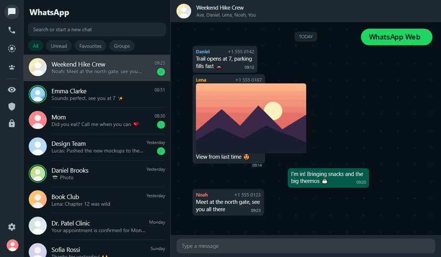
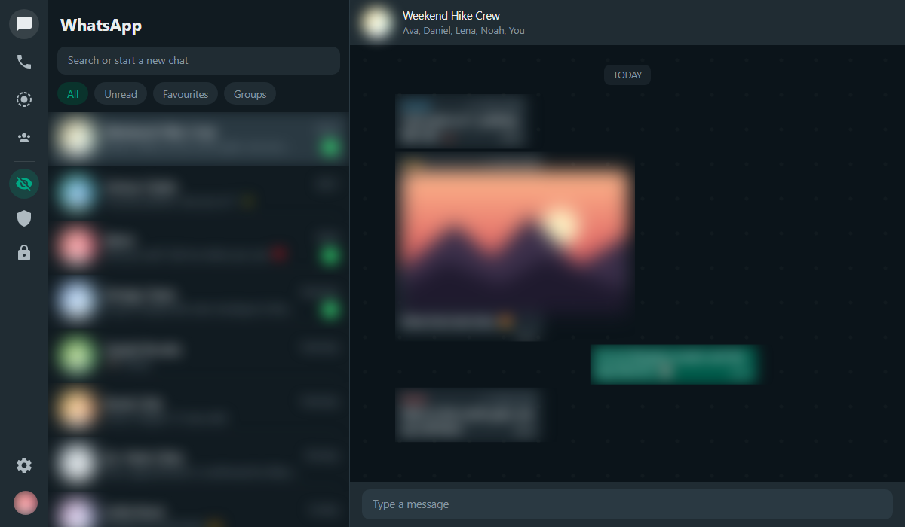
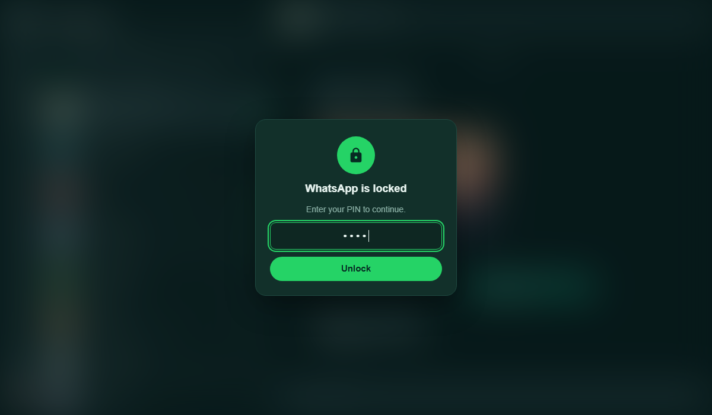
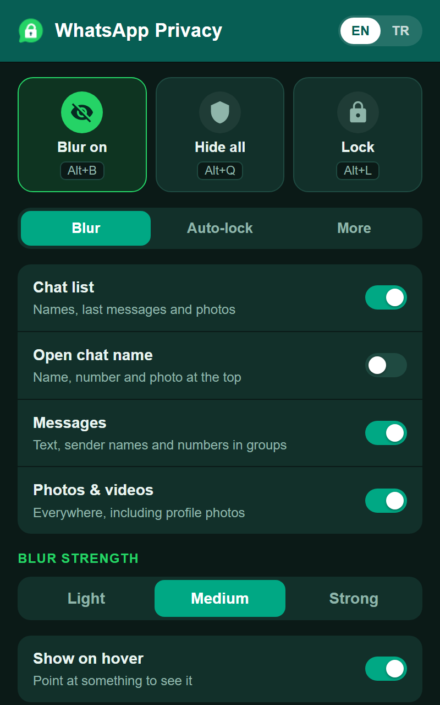

# WhatsApp Privacy

**Blur, hide and lock WhatsApp Web, so the people behind you see nothing.**

## Features

- **Smart blur:** chat list, messages, group sender names and numbers, and photos and videos. Point at something to peek.
- **Hide all:** one click, or <kbd>Alt</kbd>+<kbd>Q</kbd>, blurs the whole screen.
- **PIN lock:** <kbd>Alt</kbd>+<kbd>L</kbd> locks WhatsApp. With a PIN set, it also locks on every launch and protects the settings.
- **Automatic:** blurs after 2 minutes and locks after 10 minutes without activity. You can change both.
- **Sidebar buttons:** Blur, Hide all and Lock sit right inside WhatsApp's own icon bar.
- **English and Turkish:** switch with one click.
- **100% local:** no servers, no analytics, and no permissions besides `storage`.

| Blurred | Locked | Popup |
| :---: | :---: | :---: |
|  |  |  |

## Install

1. [Download the ZIP](https://github.com/MetehanDemirel/Whatsapp-Privacy/archive/refs/heads/main.zip) and unzip it, or `git clone` this repo.
2. Open `chrome://extensions` and turn on **Developer mode**.
3. Click **Load unpacked** and select the folder.
4. Open [web.whatsapp.com](https://web.whatsapp.com). That's it.

It works in Chrome, Edge, Brave and other Chromium browsers.

## Shortcuts

| Keys | Action |
| --- | --- |
| <kbd>Alt</kbd>+<kbd>B</kbd> | Blur on / off |
| <kbd>Alt</kbd>+<kbd>Q</kbd> | Hide everything |
| <kbd>Alt</kbd>+<kbd>L</kbd> | Lock |

You can change them at `chrome://extensions/shortcuts`.

## How it stays working

WhatsApp changes its page structure often. This extension targets plain page structure (ARIA roles, images, message IDs), never WhatsApp's generated class names. If something stops matching, it blurs the whole area instead of leaving it exposed. Hide all and the lock don't depend on WhatsApp's layout at all.

If something stops being blurred, update the `REGIONS` and `RULES` tables at the top of [`content.js`](content.js).

## Good to know

- The lock is a privacy screen against people looking at your screen, not a security boundary. Lock your computer (<kbd>Win</kbd>+<kbd>L</kbd>) when you walk away.
- Plain HTML, CSS and JavaScript. No build step, no dependencies.

---

Not affiliated with, endorsed by, or connected to WhatsApp or Meta. "WhatsApp" is a trademark of WhatsApp LLC. Screenshots use made-up contacts. · [MIT License](LICENSE)
